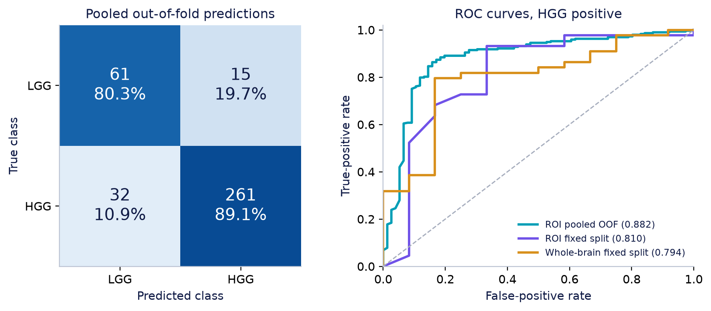
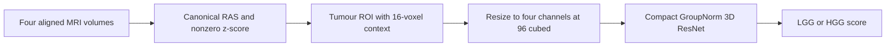
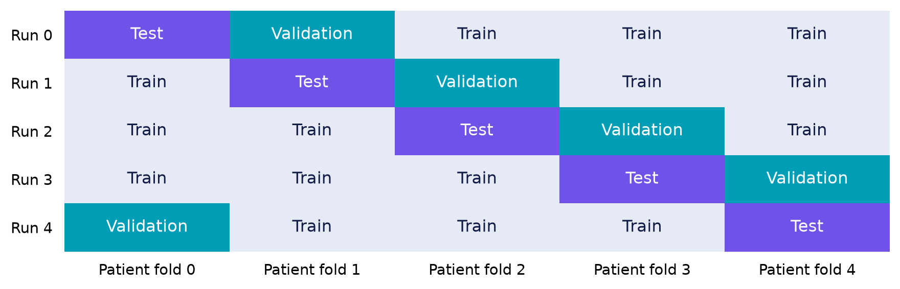

# Patient-Level Glioma Grade Classification from Multimodal 3D MRI

**B.Tech Project I · Indian Institute of Technology Kharagpur**

Ayush Goel, 23CH10092 · Department of Chemical Engineering

Supervisor: Prof. Nikita Saxena, Department of Chemical Engineering

A supervised 3D MRI baseline for the legacy high-grade glioma (HGG) and low-grade glioma (LGG) labels in BraTS 2020. The project includes patient-level data checks, four-modality preprocessing, a compact 3D residual network and the recorded results of seven GPU model fits.

**Project documents:** [Report PDF](report/BTP_Report.pdf) · [LaTeX source](report/latex/main.tex) · [Presentation](presentation/BTP_Presentation.pptx) · [Cleaned executed notebook](notebooks/BTP1_GPU_Cleaned_Review.ipynb) · [Fresh-run notebook](notebooks/BTP1_GPU_Run_Notebook.ipynb)

The report is a review draft with unsigned declaration and certificate pages. The presentation is the retained 16-slide version.

## Research questions

1. Can a compact 3D CNN distinguish HGG and LGG from four aligned MRI volumes?
2. How much does performance vary across patient-disjoint test folds?
3. How do tumour-region and whole-brain inputs compare on the same fixed patient split?

## Recorded GPU results

All main experiments use four MRI channels, `96 × 96 × 96` inputs, base width 16 and seed 42.

| Experiment | Evaluated patients | Accuracy | Balanced accuracy | Macro-F1 | ROC-AUC |
| --- | ---: | ---: | ---: | ---: | ---: |
| ROI fixed split | 56 | 83.93% | 71.59% | 73.63% | 0.8097 |
| ROI pooled five-fold OOF | 369 | 87.26% | 84.67% | 81.96% | 0.8815 |
| Whole-brain fixed split | 56 | 75.00% | 65.91% | 64.94% | 0.7936 |

The pooled ROI predictions correctly classify 322 of 369 patients: 61 of 76 LGG cases and 261 of 293 HGG cases. Mean fold balanced accuracy is **84.57%**, with sample SD **5.65 percentage points**. Pooled AUC is **0.8815**; mean fold AUC is **0.9008**. These aggregation schemes are distinct.



The ROI and whole-brain fixed rows evaluate identical patients. Their comparison gives a balanced-accuracy difference of 5.68 percentage points. The pooled ROI row uses a different evaluation scheme and does not isolate the cropping effect relative to the fixed whole-brain row.

**Implementation finding:** the archived trainer configures class weights, but mean-reduced cross-entropy cancels them at physical batch size one. The recorded models therefore use effectively **unweighted cross-entropy**. Gradient accumulation does not restore the weighting. The source is preserved as executed; no corrected-loss GPU rerun is claimed. See [known limitations](docs/KNOWN_LIMITATIONS.md).

Full fold scores, confusion counts and timings appear in [Executed results](results/EXECUTED_RESULTS.md). To recalculate the saved metrics without downloading MRI or installing PyTorch:

```bash
python scripts/verify_results.py
```

## Dataset

The selected labelled BraTS 2020 training cohort contains **369 patients: 293 HGG and 76 LGG**. Each patient has FLAIR, T1, contrast-enhanced T1 and T2 volumes, plus a tumour segmentation. The local uncompressed cohort contains 1,845 NIfTI files and occupies approximately 30.83 GiB.

All 369 patients remain in the study. Resizing reduces spatial resolution rather than patient count. The ROI model uses the supplied segmentation for localization and requires a mask at inference. Its input has four MRI channels, not five.

| Fixed partition | LGG | HGG | Total |
| --- | ---: | ---: | ---: |
| Train | 53 | 204 | 257 |
| Validation | 11 | 45 | 56 |
| Test | 12 | 44 | 56 |

Dataset source and acquisition instructions: [Data guide](data/README.md). Original MRI volumes and processed tensors are not committed to Git.

## Method



The network has eight residual blocks, stage widths 16/32/64/128 and **2,081,186 trainable parameters**. It uses GroupNorm, global average pooling, dropout 0.30 and a two-logit classification head. Training starts from random initialization.

The recorded settings are AdamW, learning rate `2e-4`, weight decay `1e-4`, physical batch one, four-step accumulation, mixed precision and gradient clipping at norm five. Checkpoints maximize validation balanced accuracy. Training allows 60 epochs with early-stopping patience 12.

For each CV rotation, fold `k` is test, fold `(k + 1) mod 5` is validation and the remaining three folds train a new model. Every patient contributes exactly one outer-test prediction. This is a rotating train/validation/test protocol with one random seed.



See [Method specification](docs/METHOD.md) for tensor shapes and preprocessing details.

## Run the project

Use Python 3.11 or later for a new environment. Install a PyTorch build appropriate for your CPU or CUDA runtime, then install the project:

```bash
git clone https://github.com/ayushgoel001/btp-3d-glioma-classification.git
cd btp-3d-glioma-classification
python -m pip install -e ".[download,dev]"
python scripts/verify_results.py
python -m pytest -q
```

The tests use small synthetic NIfTI volumes to check preprocessing, model execution and split handling. Reported research scores come from the saved real-data Colab experiments, not these synthetic tests.

For the existing Google Drive workflow, upload [the code bundle](notebooks/btp1_gpu_code.zip) to `MyDrive/BTP1_GPU/` and [open the fresh-run notebook in Colab](https://colab.research.google.com/github/ayushgoel001/btp-3d-glioma-classification/blob/main/notebooks/BTP1_GPU_Run_Notebook.ipynb). Run the numbered steps in order. New runs use timestamped output directories.

The [reproduction guide](docs/REPRODUCING.md) also provides the direct CLI commands. The JSON in `configs/` is a reference record; the CLI arguments and notebook supply the actual settings.

## Repository map

```text
src/btp3d/       Data audit, preprocessing, network, training, CV and inference
configs/        Reference configuration for the recorded GPU baseline
notebooks/      Original evidence, cleaned record, fresh-run notebook and code bundle
results/        Executed results, per-patient predictions, histories and provenance
figures/        Scientific figures derived from the frozen GPU results
data/           Data instructions, grade mapping and portable patient split table
report/         Review report PDF and portable LaTeX project
presentation/   Retained 16-slide defence presentation
literature/     Primary references used in the report
docs/           Method, reproduction instructions and implementation limitations
scripts/        Dataset helper, bundle builder and evidence verifier
tests/          CPU pipeline checks using synthetic inputs
.github/        CPU tests and evidence checks for GitHub Actions
```

## Reproducibility and scope

- [Original executed notebook](notebooks/BTP1_GPU_Executed.ipynb) preserves the setup history. The cleaned copy is an edited presentation of the same experiment, with retained result outputs preserved.
- [Compact GPU evidence](results/gpu/) contains metrics, histories, predictions and original runtime manifests. Paths inside those manifests record the Colab session and must be rebuilt for another machine.
- [Source record](results/provenance/source_record.json) records hashes and verifies that all training modules match the executed source archive.
- MRI volumes, caches, checkpoints and the large results ZIP remain outside Git. Training regenerates checkpoints; the repository alone does not contain pretrained weights.
- Validation is internal to one cohort and one seed. The study does not include external validation, probability calibration, self-supervised pretraining or automated segmentation.

AI assistance supported development, debugging, artifact checks and document preparation. The student remains responsible for reviewing the work and its interpretation. The [report](report/BTP_Report.pdf) contains the fuller disclosure and limitations.

## References and licensing

Dataset, residual learning, GroupNorm, AdamW and loss-reduction sources are listed in [Primary references](literature/references.md). Third-party datasets and software retain their respective terms. No project software license has been selected; see [NOTICE](NOTICE.md).
